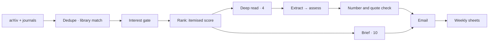
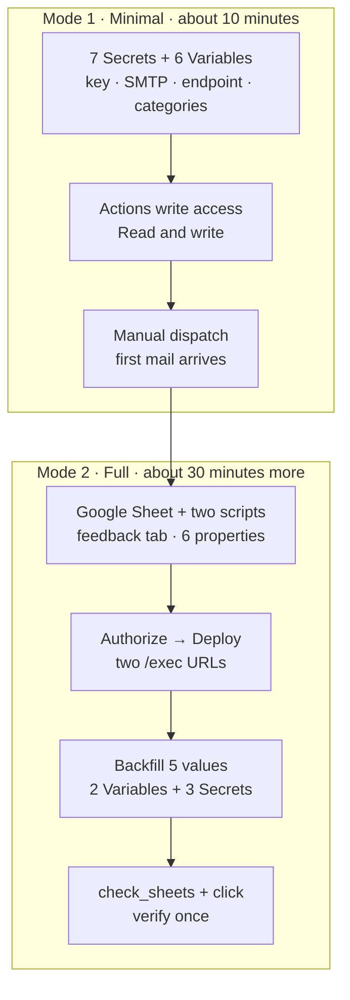

<div align="center" markdown="1">

# arXiv Digest

**One email a day. Only what is worth reading.**

Filtered coldly, then handed over.

[](CHANGELOG.md)
[](pyproject.toml)
[](LICENSE)
[](tests/)
[](arxiv_digest/selfcheck.py)
[](.github/workflows/daily-arxiv-digest.yml)

[](#)
[](README.md)

</div>

---

It is not another feed you subscribed to.

It does one thing a day: it reads everything that appeared on arXiv and a handful of astronomy journals, drops what you have already seen, what is unrelated to your field, and what has nothing to say, then hands over the rest. Four papers worth reading through, ten worth a glance. If you read only one, it will not take offense.

Judgment is not outsourced. The model extracts facts and applies rules; every number has to be traceable to the source text. No flattery, only checkable numbers.

---

<table>
<tr>
<td colspan="2" align="center"><sub><b>— Sources · Selection —</b></sub></td>
</tr>
<tr>
<td width="50%" valign="top">

<h4>🛰️ Six sources, one intake</h4>

arXiv (including cross-lists), plus <b>ApJ, MNRAS, Nature Astronomy, AJ, A&amp;A</b>.
Journal papers are matched back to their arXiv preprint by title for full text; the venue stays the journal.
Anything already in your Zotero library is recognised, not sold back to you as news.

</td>
<td width="50%" valign="top">

<h4>🧮 The score, itemised</h4>

Keywords, Zotero, categories, library, feedback — each priced separately, summed into the total.
No black box, no "overall rating".
The email shows which term did the work.

</td>
</tr>
<tr>
<td colspan="2" align="center"><sub><b>— Reading · Judgment —</b></sub></td>
</tr>
<tr>
<td width="50%" valign="top">

<h4>📖 Twelve sections, enough to decide</h4>

Verdict, background, method, method chain, seven questions, key numbers, figure cues, what to do today, red flags, glossary, Chinese and English abstracts.

Not a paraphrase of the abstract — the material you need to decide whether to read.

</td>
<td width="50%" valign="top">

<h4>🧾 Two stages, evidence first</h4>

Extract: data, processing, systematics, method, result, author limitations — each with a quote.
Assess: only the extracted facts; numbers must be traceable; gaps are labelled "not found", never invented.

</td>
</tr>
<tr>
<td colspan="2" align="center"><sub><b>— Feedback · Accumulation —</b></sub></td>
</tr>
<tr>
<td width="50%" valign="top">

<h4>🎯 Two questions, not five</h4>

"Relevant to me" and "useful to me", three levels each.
Answers land in a sheet, aggregated by topic and week; the next ranking remembers.
It does not ask how you feel. It asks what happened.

</td>
<td width="50%" valign="top">

<h4>🗂️ Trends, counted</h4>

Everything collected lands in a weekly sheet: topic share, four-week moving average, journal-to-preprint ratio, rising and falling.
The model is not allowed to declare a trend. Only counts.

</td>
</tr>
</table>

---

## What one email contains

| Section | Content | Author |
| --- | --- | --- |
| Header | Papers today, window, theme | Program |
| Overview | The thread of today's issue | Model (numbers checked) |
| Weekly pulse | What kept recurring this week | Model (rule fallback) |
| Neighbour radar | One paragraph on what moved elsewhere; entries collapsed below | Rules + model overview |
| Calendar | Meetings, deadlines, observing calls | Config |
| Deep read · 4 | Full twelve-section cards | Two-stage analysis |
| Brief · 10 | One line, score, abstract | Single stage |
| World in motion | Astronomy, physics, chemistry, history & archaeology | Secondary sources |
| Submission trend | This week vs last week, sampled | Collection stats |

**The twelve sections**: verdict and reading advice · score breakdown · background · method · method chain · seven Q&A · key numbers · figure cues · what to do today · red-flag audit · glossary · bilingual abstracts.

"Full-text excerpt" means an excerpt. Not detecting something does not mean the paper never discussed it; the card says so.

---

## How it judges

**Total = keywords + Zotero similarity + category bonus + library flag + learned feedback**

| Term | Rule | Cap |
| --- | --- | --- |
| Keywords | `0.8 × hits` per keyword | 3.0 each |
| Zotero | Bag-of-words overlap with starred items (title weighted 2×) | −2.5 ~ +3.0 |
| Categories | `0.2 × min(count, 2)` | 0.4 |
| Library | Already saved: −3.0, labelled | — |
| Feedback | 0.65 relevance + 0.35 usefulness, by category and author | ±1.8 |

Stars are just another way to write the score. The email gives the score and where it came from — not adjectives.

**Hard rules**: every number must be found in the source. If it cannot be found, the clause is removed or marked "not found". A single unsupported clause is dropped; the whole section is not.

---

## What it accumulates

One Google spreadsheet, five tabs:

| Tab | One row is |
| --- | --- |
| `papers` | A collected paper (score breakdown, selected, deep-read) |
| `weekly_topics` | One week × one topic: count, share, delta, 4-week average |
| `weekly_overview` | One week: totals, journal vs preprint, top five topics |
| `dict` | Topic dictionary: aliases, pack, first and last seen |
| `feedback_view` | One week × one topic: votes, mean relevance, mean usefulness |

The feedback sheet and the archive may share one spreadsheet, each with its own web app. `python -m scripts.check_sheets` says so plainly when a `gid` points at the wrong tab.

---

## How it runs



Delivery is recorded only after the mail is accepted. A preview consumes no state and sends nothing; a failure is not quietly patched the next day.

---

## Quick start

```bash
git clone https://github.com/Supercell023/arxiv-astro-digest.git
cd arxiv-astro-digest
python -m venv .venv && . .venv/bin/activate
pip install -r requirements.txt
cp .env.example .env
```

Minimal `.env`:

```dotenv
OPENAI_API_KEY=...
OPENAI_BASE_URL=https://your-endpoint/v1
OPENAI_MODEL=deepseek-flash
ANALYSIS_ENABLED=true
```

Verify first, free of charge:

```bash
python -m arxiv_digest.selfcheck           # 27 checks, offline
python -m arxiv_digest.main --out preview.html
```

To deliver, add the five SMTP values: `SMTP_HOST`, `SMTP_PORT`, SMTP user and password, `EMAIL_FROM`, `EMAIL_TO`.

To have it mail itself every day in the cloud, configure in two stages: first make delivery work, then decide whether you want feedback and archive.



What each value is and where to get it: [docs/CONFIG.md](docs/CONFIG.md), section "〇、配置路径".

<details>
<summary><b>Commands</b></summary>

<br>

| Command | Purpose |
| --- | --- |
| `python -m arxiv_digest.selfcheck` | Offline self-check, 27 items |
| `python -m arxiv_digest.main --out preview.html` | Preview; no send, no state |
| `python -m arxiv_digest.main` | Deliver |
| `python -m scripts.build_preview --out preview.html` | Sample email (recorded replay) |
| `python -m scripts.build_preview --replay digest.json --out preview.html` | Replay a snapshot |
| `python -m unittest discover -s tests -v` | 176 offline tests |
| `python -m scripts.preview_digest` | Frozen evaluation set |
| `python -m scripts.feedback_server` | Local feedback endpoint (127.0.0.1:8765) |
| `python -m scripts.feedback record --id <id> --rel 2 --use 1` | Record a vote |
| `python -m scripts.feedback stats` | Inspect learned weights |
| `python -m scripts.check_sheets` | Check both sheet wirings |
| `python -m arxiv_digest.archive --health` | Archive endpoint health |
| `python -m scripts.eval_analysis check` | Validate the evaluation set |

</details>

<details>
<summary><b>Configuration</b></summary>

<br>

| Variable | Default | Meaning |
| --- | --- | --- |
| `DEEP_PAPERS` / `BRIEF_PAPERS` | 4 / 10 | Layout only; content is written to the evidence |
| `ANALYSIS_ENABLED` | false | Two-stage deep read |
| `FULLTEXT_ENABLED` | true | Fetch full PDFs; no truncation |
| `PREPRINT_ENABLED` | true | Resolve journal DOIs to arXiv preprints |
| `JOURNALS_ENABLED` | true | ApJ / MNRAS / NatAs / AJ / A&A |
| `ARCHIVE_ENABLED` | true | Write the sheet (skipped when no URL) |
| `ZOTERO_SKIP_COLLECTED` | false | Filter out what you already saved |
| `FEEDBACK_URL` | empty | Feedback buttons; hidden when empty |
| `FEEDBACK_SHEET_CSV_URL` | empty | CSV read-back of votes |
| `DIGEST_TIMEZONE` | Asia/Shanghai | What "today" means |
| `FIELDS` | empty | Domain packs; empty = all |

The full list is in [docs/CONFIG.md](docs/CONFIG.md). Secrets belong in `.env` or repository secrets; glance at `git status` before committing.

</details>

---

## Make it yours

Three places and it is your digest:

- `config/profile.yaml` — your field, probes, reading order
- `config/packs/*.yaml` — domain packs: categories, topic aliases, red flags
- `config/journals.yaml` — which journals to watch

Three packs ship in the box: `galaxy_cosmology`, `galaxy_formation`, `generic`. Copy one and edit.

---

## Versions

| Version | In one line |
| --- | --- |
| v0.12 | Itemised scores, background sections, two-dimensional feedback, journals, Zotero |
| v0.13 | Sunday weekly edition, wider world news, R01–R09 fixes |
| v0.14 | Weekly and news policy settled; frozen evaluation set |
| v0.15 | Journal papers resolved to arXiv preprints for full text |
| v0.15.1 | Keyword-aware excerpts; escaped separator fix |
| v0.16 | Long-term archive: every collected paper, by week |
| v0.17 | Votes aggregated by topic; one spreadsheet for both |
| v0.17.1 | Sheet wiring checker |
| v0.18 | No English left in Chinese summaries; radar is one paragraph |

Earlier history: [CHANGELOG.md](CHANGELOG.md).

<details>
<summary><b>Upgrade notes</b></summary>

<br>

1. Diff `.env.example` first; new keys have defaults, but behaviour may have changed.
2. Comments in `.env` must sit on their own line, never after a value.
3. `state.json` is v2; older files are ignored, not migrated.
4. `deepseek-chat` is retired; use `deepseek-flash` or your own model.
5. Run `python -m arxiv_digest.selfcheck` (27 items) after upgrading.
6. Feedback has been two-dimensional since v0.12; old votes are mapped by level.

</details>

---

## What it does not promise

| Not available | Why |
| --- | --- |
| Astrobites full text | The site returns 403 |
| Nature Astronomy abstracts | Crossref often has only the title |
| Publisher PDFs | Anti-bot walls; falls back to the preprint |
| Preprint vs version of record | Not compared; one version only |
| Sites without RSS | Not scraped |
| Live gravitational-wave alerts | Out of scope |
| Paper discussion, citation graphs | Not integrated |

Nor does it promise: that every PDF has a text layer, that the daily volume is stable, that `<details>` expands in every mail client, or that Outlook renders textures. What it does promise: anything stated can be traced back to the source.

---

## Documents

| Document | Contents |
| --- | --- |
| [docs/CONFIG.md](docs/CONFIG.md) | Every setting |
| [docs/FEEDBACK.md](docs/FEEDBACK.md) | Two-dimensional feedback and shared sheets |
| [docs/ARCHIVE.md](docs/ARCHIVE.md) | The archive and its deployment |
| [docs/PRODUCT_PLAN.md](docs/PRODUCT_PLAN.md) | Product judgment and definitions |
| [docs/AI_HANDOFF.md](docs/AI_HANDOFF.md) | Handoff, limits, unverified items |
| [CHANGELOG.md](CHANGELOG.md) | Version-by-version changes |

MIT. Use it or not, no need to say hello.

<div align="center" markdown="1"><sub>It does not chase trends. It puts what is worth reading in front of you before you ask.</sub></div>
