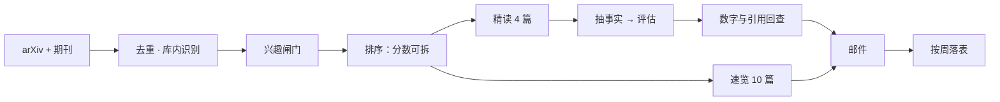
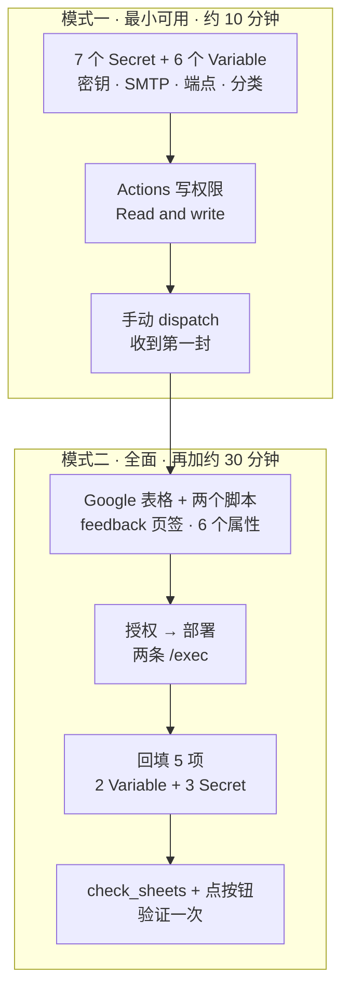

<div align="center" markdown="1">

# arXiv Digest

**每天一封。只留值得读的。**

冷眼筛过一遍，再交到你手上。

[](CHANGELOG.md)
[](pyproject.toml)
[](LICENSE)
[](tests/)
[](arxiv_digest/selfcheck.py)
[](.github/workflows/daily-arxiv-digest.yml)

[](#)
[](README.en.md)

</div>

---

它不是你订阅的又一个资讯流。

它每天只做一件事：把 arXiv 和几本天文期刊里当天出现的东西全部过一遍，去掉你已经见过的、和你的方向无关的、没有实质内容的，然后把剩下的交给你。四篇值得读透，十篇扫一眼。你若只想读一篇，它也不会觉得被冒犯。

判断不外包。AI 只负责抽事实和照规则打分，每个数字都要能回到原文。漂亮话没有，可回查的数字有。

---

<table>
<tr>
<td colspan="2" align="center"><sub><b>— 来源 · 筛选 —</b></sub></td>
</tr>
<tr>
<td width="50%" valign="top">

<h4>🛰️ 六个来源，一次收口</h4>

arXiv（含 cross-list），加上 <b>ApJ、MNRAS、Nature Astronomy、AJ、A&amp;A</b>。
期刊论文按标题反查 arXiv 预印本取全文，署名仍然是期刊，不做偷换。
已经在 Zotero 库里的，会被认出来，不再当作新发现推销给你。

</td>
<td width="50%" valign="top">

<h4>🧮 分数，拆开给你看</h4>

关键词、Zotero、分类、库内、反馈，五项各自标价，相加就是总分。
没有黑箱，也没有“综合评分”。
哪一项在起作用，邮件里写得清清楚楚。

</td>
</tr>
<tr>
<td colspan="2" align="center"><sub><b>— 阅读 · 判断 —</b></sub></td>
</tr>
<tr>
<td width="50%" valign="top">

<h4>📖 十二个分区，读完就能判断</h4>

一句话结论、研究背景、研究方法、方法链、七问七答、关键数字、图表线索、今天能做什么、红旗反查、术语小抄、中英摘要。

不是摘要的复述，是给你决定“读不读”的材料。

</td>
<td width="50%" valign="top">

<h4>🧾 两阶段，证据先行</h4>

先抽事实：数据、处理、系统误差、方法、结果、作者局限，每条带原文引用。
再评估：只用手上这些事实，数字必须可回查，缺失就写“未检出”，不许编。

</td>
</tr>
<tr>
<td colspan="2" align="center"><sub><b>— 反馈 · 积累 —</b></sub></td>
</tr>
<tr>
<td width="50%" valign="top">

<h4>🎯 两个问题，不是五个</h4>

“和我相关吗”与“对你有用吗”，各三档。
答案回写到一张表，按主题与周聚合；下一次排序会记得。
它不问感受，只问事实。

</td>
<td width="50%" valign="top">

<h4>🗂️ 热点，是数出来的</h4>

全量采集按周落表：主题份额、四周移动平均、期刊与预印本的比例、上升与回落。
不让模型断言“变热”，只给可核对计数。

</td>
</tr>
</table>

---

## 一封邮件里有什么

| 板块 | 内容 | 谁写的 |
| --- | --- | --- |
| 报头 | 今天几篇、覆盖几天、哪一种版式 | 程序 |
| LLM 总览 | 今天这封的整体脉络 | 模型（数字回查） |
| 本周脉搏 | 这一周在反复出现的线索 | 模型（规则兜底） |
| 邻域雷达 | 一段话：别的方向这周在动什么（条目折叠在下方） | 规则 + 模型综述 |
| 近期日程 | 会议、截稿、观测申请 | 配置 |
| 精读 · 4 篇 | 十二分区完整卡片 | 两阶段分析 |
| 速览 · 10 篇 | 一句话 + 分数构成 + 摘要 | 单阶段 |
| 世界在动 | 天文、物理、化学、历史与考古 | 二手源（按周轮询） |
| 投稿量变化 | 本周与上周的采样对比 | 采集统计 |

**精读卡十二个分区**：一句话结论与阅读建议 · 分数构成 · 研究背景 · 研究方法 · 方法链 · 七问七答 · 关键数字 · 图表线索 · 今天能做什么 · 红旗反查 · 术语小抄 · 中英文摘要。

“全文节选”是节选，不是全文。没检出不等于原文没讨论，卡片会如实这么写。

---

## 它怎么判断

**总分 = 关键词 + Zotero 相似度 + 分类加成 + 库内标记 + 反馈学习**

| 项 | 规则 | 上限 |
| --- | --- | --- |
| 关键词 | 每个命中词 `0.8 × 次数` | 3.0 / 词 |
| Zotero | 与库里偏好文献的词袋相似度（标题权重 2×） | −2.5 ~ +3.0 |
| 分类 | `0.2 × min(分类数, 2)` | 0.4 |
| 库内 | 已收藏：−3.0 并标注“已收录” | — |
| 反馈 | 相关 0.65 + 有用 0.35，按分类/作者回填 | ±1.8 |

星级只是分数的另一种写法。邮件里给的是分数和它的来历，不是形容词。

**硬规则**：任何数字都要能在原文里找到；找不到就删掉那句话，或写“未检出”。背景与方法里出现无法回查的数字，只删那一句，不整段丢弃。

---

## 它在攒什么

一份 Google 表格，五个页签：

| 页签 | 一行是什么 |
| --- | --- |
| `papers` | 一篇采集到的论文（含分数构成、是否入选、是否精读） |
| `weekly_topics` | 一周 × 一个主题：篇数、份额、环比、四周均线 |
| `weekly_overview` | 一周一行：总量、期刊与预印本、前五主题 |
| `dict` | 主题口径：别名、领域包、首次与最近出现 |
| `feedback_view` | 一周 × 一个主题：票数、平均相关度、平均有用性 |

反馈表与档案表可以共用同一份表格，各自一个 Web App。`python -m scripts.check_sheets` 负责在你配错 `gid` 时直说。

---

## 它怎么跑



投递成功才记“已发”。预览不消费状态，不发信；失败了不会假装第二天补上。

---

## 快速开始

```bash
git clone https://github.com/Supercell023/arxiv-astro-digest.git
cd arxiv-astro-digest
python -m venv .venv && . .venv/bin/activate
pip install -r requirements.txt
cp .env.example .env
```

`.env` 最小可用：

```dotenv
OPENAI_API_KEY=...
OPENAI_BASE_URL=https://your-endpoint/v1
OPENAI_MODEL=deepseek-flash
ANALYSIS_ENABLED=true
```

先验一遍，不花钱：

```bash
python -m arxiv_digest.selfcheck           # 27 项，离线
python -m arxiv_digest.main --out preview.html
```

要发到邮箱，再补 SMTP 五项：`SMTP_HOST`、`SMTP_PORT`、SMTP 用户与密码、`EMAIL_FROM`、`EMAIL_TO`。

要在云端每天自己发信，配置分两段走：先让邮件到得了，再决定要不要反馈与档案。



逐项填什么、从哪拿，见 [docs/CONFIG.md](docs/CONFIG.md) 的「〇、配置路径」。

<details>
<summary><b>常用命令</b></summary>

<br>

| 命令 | 用途 |
| --- | --- |
| `python -m arxiv_digest.selfcheck` | 离线自检，27 项 |
| `python -m arxiv_digest.main --out preview.html` | 生成预览，不发信、不消费状态 |
| `python -m arxiv_digest.main` | 正式投递 |
| `python -m scripts.build_preview --out preview.html` | 样例邮件（录制回放） |
| `python -m scripts.build_preview --replay digest.json --out preview.html` | 用快照回放 |
| `python -m unittest discover -s tests -v` | 176 项离线测试 |
| `python -m scripts.preview_digest` | 固定评测集 |
| `python -m scripts.feedback_server` | 本机反馈端点（127.0.0.1:8765） |
| `python -m scripts.feedback record --id <id> --rel 2 --use 1` | 命令行记一票 |
| `python -m scripts.feedback stats` | 看学到的偏好 |
| `python -m scripts.check_sheets` | 检查两张表接线 |
| `python -m arxiv_digest.archive --health` | 档案端点连通性 |
| `python -m scripts.eval_analysis check` | 评测集校验 |

</details>

<details>
<summary><b>配置</b></summary>

<br>

| 变量 | 默认 | 说明 |
| --- | --- | --- |
| `DEEP_PAPERS` / `BRIEF_PAPERS` | 4 / 10 | 只决定排版；内容按证据写足 |
| `ANALYSIS_ENABLED` | false | 精读两阶段分析 |
| `FULLTEXT_ENABLED` | true | 抓 PDF，整篇全文送给模型 |
| `PREPRINT_ENABLED` | true | 期刊论文反查 arXiv 预印本 |
| `JOURNALS_ENABLED` | true | ApJ / MNRAS / NatAs / AJ / A&A |
| `ARCHIVE_ENABLED` | true | 写 Google 表格（未配 URL 自动跳过） |
| `ZOTERO_SKIP_COLLECTED` | false | 库里已有的直接过滤 |
| `FEEDBACK_URL` | 空 | 邮件里的反馈按钮，空则不显示 |
| `FEEDBACK_SHEET_CSV_URL` | 空 | 回读投票的 CSV 地址 |
| `DIGEST_TIMEZONE` | Asia/Shanghai | “今天”的口径 |
| `FIELDS` | 空 | 领域包，空 = 全部 |

完整清单与逐项说明见 [docs/CONFIG.md](docs/CONFIG.md)。密钥只放 `.env` 或仓库 Secrets，提交前过一眼 `git status`。

</details>

---

## 换成你的方向

三处，改完就是你的简报：

- `config/profile.yaml` — 你的方向、探针、读解顺序
- `config/packs/*.yaml` — 领域包：分类、主题别名、预置红旗
- `config/journals.yaml` — 关注哪些刊

内置 `galaxy_cosmology`、`galaxy_formation` 与 `generic` 三个包，照着抄即可。

---

## 版本

| 版本 | 一句话 |
| --- | --- |
| v0.12 | 分数可拆、精读讲背景、反馈两维、期刊入库、Zotero 真参与 |
| v0.13 | 周日周报、世界新闻扩域、R01–R09 修复 |
| v0.14 | 周报与世界新闻策略成形，固定评测集闭环 |
| v0.15 | 期刊论文按标题反查 arXiv，取全文 |
| v0.15.1 | 全文节选改为关键词节选，修分隔符转义 |
| v0.16 | 长期热点档案：全量论文按周落表 |
| v0.17 | 反馈票按主题聚合，可与档案共用一份表格 |
| v0.17.1 | 合表自检脚本 |
| v0.18 | 中文摘要不留英文、雷达改成一段话 |

更早的历史见 [CHANGELOG.md](CHANGELOG.md)。

<details>
<summary><b>升级注意</b></summary>

<br>

1. 升级前对比 `.env.example`，新增项都有默认值，但行为可能已经改变。
2. `.env` 里注释必须独立成行，不能写在值后面。
3. `state.json` 已是 v2；旧版会被忽略，不会静默迁移。
4. `deepseek-chat` 已下线，改用 `deepseek-flash` 或自备模型。
5. 升级后先跑 `python -m arxiv_digest.selfcheck`（27 项）。
6. 反馈从 v0.12 起是两维（相关 / 有用），旧票会按档位折算。

</details>

---

## 它不承诺什么

| 拿不到 | 说明 |
| --- | --- |
| Astrobites 全文 | 站点返回 403 |
| Nature Astronomy 摘要 | Crossref 常只给标题 |
| 期刊正文 PDF | IOP 等反爬；退而取预印本 |
| 预印本与正式版差异 | 不比较版本，只认一次 |
| 没有 RSS 的站点 | 不硬抓 |
| 实时引力波事件 | 不在采集范围 |
| 论文讨论区、引用图谱 | 尚未接入 |

也不承诺：扫描版 PDF 有文本层、采集量每天一样、`<details>` 在所有邮件客户端都能展开、Outlook 会渲染纹理、数字回查等于语义正确。它只保证：说出来的，都能指回原文。

---

## 文档

| 文档 | 内容 |
| --- | --- |
| [docs/CONFIG.md](docs/CONFIG.md) | 全部配置项 |
| [docs/FEEDBACK.md](docs/FEEDBACK.md) | 两维反馈与合表 |
| [docs/ARCHIVE.md](docs/ARCHIVE.md) | 热点档案与部署 |
| [docs/PRODUCT_PLAN.md](docs/PRODUCT_PLAN.md) | 产品判断与口径 |
| [docs/AI_HANDOFF.md](docs/AI_HANDOFF.md) | 交接、边界、未验收项 |
| [CHANGELOG.md](CHANGELOG.md) | 逐版本改动 |

MIT。用或不用，都不必打招呼。

<div align="center" markdown="1"><sub>不追热点。只在你开口之前，把值得看的放到你面前。</sub></div>
