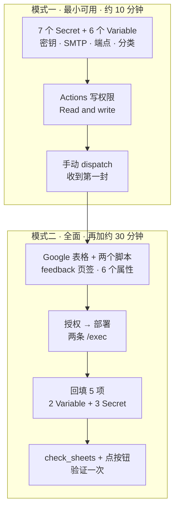

# 配置指南

> v0.13 新增项与迁移以 [改动报告](CHANGE_REPORT_2026-10-26.md) 为准。真正离线预览使用 `python scripts/build_preview.py`；`main --out` 会抓取、调用模型并写诊断/缓存，但不消费已读状态。

这份文档回答两个问题：**每个变量是什么意思、什么时候该改它**，以及**用哪个邮箱发信**。

配置有三个来源，优先级从高到低：

1. **环境变量**（GitHub Actions 里的 Secrets / Variables）
2. **`.env` 文件**（本地开发；已被 `.gitignore` 排除）
3. **代码里的默认值**（`arxiv_digest/config.py`）

空字符串等同"没设置"，会回落到默认值。所以留空是安全的，不会把功能关掉（开关类变量的空值语义见 [第四节](#四开关类变量空值是什么意思)）。

---

## 〇、配置路径：先最小，再全面

本地验证只要四行 `.env`（见下一节）。要让它在 GitHub Actions 上每天自己发信，按两条路径走。



### 模式一：13 项

仓库 **Settings → Secrets and variables → Actions**，Secrets 与 Variables 各建一张表。

| # | 放哪 | 变量 | 填什么 | 从哪拿 |
| --- | --- | --- | --- | --- |
| 1 | Secret | `OPENAI_API_KEY` | `sk-` 开头的密钥 | 中转站或 DeepSeek 控制台 |
| 2 | Secret | `SMTP_HOST` | `smtp.qq.com` 等 | [第二节](#二用哪个邮箱发信)的对照表 |
| 3 | Secret | `SMTP_PORT` | `465`（SSL）或 `587`（STARTTLS） | 同上 |
| 4 | Secret | `SMTP_USERNAME` | 完整邮箱地址 | 你的账号 |
| 5 | Secret | `SMTP_PASSWORD` | 授权码，不是登录密码 | 邮箱设置里生成 |
| 6 | Secret | `EMAIL_FROM` | 一般与 `SMTP_USERNAME` 相同 | 你的账号 |
| 7 | Secret | `EMAIL_TO` | 收件邮箱，可逗号分隔多个 | 你的账号 |
| 8 | Variable | `OPENAI_BASE_URL` | `https://api.deepseek.com/v1` | 中转站给的地址 |
| 9 | Variable | `OPENAI_MODEL` | `deepseek-flash` 等 | 与端点匹配的模型名 |
| 10 | Variable | `DIGEST_TIMEZONE` | `Asia/Shanghai` | 决定"今天"的口径 |
| 11 | Variable | `ANALYSIS_ENABLED` | `true` | 默认 false，不开精读只剩一两句 |
| 12 | Variable | `ARXIV_CATEGORIES` | `astro-ph.CO,astro-ph.GA` | 英文逗号分隔 |
| 13 | Variable | `ARXIV_KEYWORDS` | 你的研究词 | 逗号分隔，重复会自动去重 |

两点容易出错：`SMTP_PORT` 必须放 **Secrets**（工作流读的是 `secrets.SMTP_PORT`）；仓库权限要到 **Settings → Actions → General → Workflow permissions** 选 **Read and write**，否则 `state.json` 写不回去，第二天会重复推送。

### 模式二：Google 侧 6 个属性 + 回填 5 项

一份表格、两个 Apps Script，各自独立部署。

**表格**：新建后把第一张页签改名为 `feedback`，`A1:D1` 填 `item`、`relevance`、`usefulness`、`t`。其余页签由档案脚本首次写入时自动创建，不要手改表头。

**反馈脚本**（`scripts/google_feedback.gs`）的脚本属性：

| 属性 | 值 |
| --- | --- |
| `FEEDBACK_SPREADSHEET_ID` | 表格地址里 `/d/` 与 `/edit` 之间那一段 |
| `FEEDBACK_SIGNING_KEY` | 随机串一 |
| `FEEDBACK_CSV_READ_TOKEN` | 随机串二，与串一不同 |
| `FEEDBACK_SHEET_NAME` | `feedback` |

**档案脚本**（`scripts/google_archive.gs`）的脚本属性：

| 属性 | 值 |
| --- | --- |
| `ARCHIVE_SPREADSHEET_ID` | 与反馈脚本同一张表 |
| `ARCHIVE_TOKEN` | 随机串三，与前两个都不同 |

随机串用 `openssl rand -hex 32`（Git Bash）、`python -c "import secrets;print(secrets.token_hex(32))"` 或 PowerShell 的 `RandomNumberGenerator` 生成，**三个值互不相同**。读取口令会出现在 URL 里，泄漏即可被改写反馈表。

两个脚本各自「部署 → 新建部署 → Web 应用 → 执行身份：我 → 访问权限：任何人」，复制得到的 `/exec` 地址（不是 `/dev`）。

**回填到 GitHub**：

| 位置 | 名称 | 值 |
| --- | --- | --- |
| Variable | `FEEDBACK_URL` | 反馈脚本的 `/exec` |
| Variable | `ARCHIVE_WEBHOOK_URL` | 档案脚本的 `/exec` |
| Secret | `FEEDBACK_SIGNING_KEY` | 与脚本属性逐字符一致 |
| Secret | `FEEDBACK_SHEET_CSV_URL` | `反馈 /exec?action=csv&token=<读取口令>` |
| Secret | `ARCHIVE_TOKEN` | 与脚本属性一致 |

改完 Apps Script 代码必须「管理部署 → 编辑 → 新版本」，否则 `/exec` 仍指向旧快照。换掉签名密钥会让已发出的邮件里所有按钮失效。

### 走完两条路径后

```bash
python -m arxiv_digest.archive --health   # 档案端点是否可用
python -m scripts.check_sheets            # 两张表接线是否对齐
```

再到 Actions 手动 dispatch 一次，`run_report.json` 里 `delivery=committed`、`archive.ok=true` 即全链路通。

---

## 一、最小可用配置

### A. 真实数据预览（不发信，会联网并可能产生模型费用）

```ini
OPENAI_API_KEY=sk-...
OPENAI_BASE_URL=https://api.deepseek.com
OPENAI_MODEL=deepseek-flash
ANALYSIS_ENABLED=true
```

```bash
python -m arxiv_digest.main --out preview.html
```

### B. 每天真的收到邮件（推荐先用这套）

在上面四行之外，再加七行：

```ini
SMTP_HOST=smtp.qq.com
SMTP_PORT=465
SMTP_USERNAME=12345678@qq.com
SMTP_PASSWORD=授权码（16 位，不是登录密码）
EMAIL_FROM=12345678@qq.com
EMAIL_TO=12345678@qq.com
DIGEST_TIMEZONE=Asia/Shanghai
```

其余变量全部留空即可——默认值已经是一套能用的配置（4 篇精读 + 10 篇速览 + 日程 + 脉搏 + 雷达 + 世界在动）。

---

## 二、用哪个邮箱发信

### 对比

| 服务 | SMTP | 端口 | 密码类型 | 国内可用 | 建议 |
| --- | --- | --- | --- | --- | --- |
| **QQ 邮箱** | `smtp.qq.com` | **465** | 授权码 | ✅ 稳 | **首选** |
| 163 邮箱 | `smtp.163.com` | 465 | 授权码 | ✅ | 次选，偶被判垃圾 |
| 腾讯企业邮 | `smtp.exmail.qq.com` | 465 | 邮箱密码/客户端专用密码 | ✅ | 有域名时用 |
| Gmail | `smtp.gmail.com` | 587 | 应用专用密码 | ❌ 本地连不上 | Actions 上可用 |
| Outlook / 365 | `smtp.office365.com` | 587 | 应用密码 | 半可用 | 微软在收紧，不推荐新配 |
| 发信服务（Resend 等） | — | 587 | API Key | ✅ | 发给别人时用，发给自己没必要 |

**推荐 QQ 邮箱**，理由很实际：465 端口是隐式 SSL，国内运营商不拦；授权码机制不会暴露登录密码；发给自己秒到，且不容易进垃圾箱。

### 拿 QQ 邮箱授权码

1. 电脑登录 [mail.qq.com](https://mail.qq.com) → 左上角 **设置** → **账号**
2. 找到「POP3/IMAP/SMTP/Exchange/CardDAV/CalDAV服务」
3. 开启 **服务：IMAP/SMTP服务**（会要求短信验证）
4. 点「生成授权码」，短信验证后拿到一串 **16 位字母**（例如 `abcdwxyzefghijkl`）
5. 这串就是 `SMTP_PASSWORD`，**只显示一次**，抄下来

> 授权码不是登录密码。改了 QQ 密码授权码依然有效；但"注销所有授权码"会让它失效。

### 三个必知的坑

**① `EMAIL_FROM` 必须等于 `SMTP_USERNAME`。**
QQ / 163 会校验发件人与登录账号是否一致，不一致直接拒发（报 `553 Mail from must equal authorized user`）。

**② 465 和 587 不能混。**
代码按端口自动选协议：**465 用隐式 SSL**，其他端口用 STARTTLS。填 587 却配 `smtp.qq.com` 会超时。

**③ 收件人写你自己就行。**
`EMAIL_TO` 可以是同一个地址，也可以另起一个小号做归档；多个地址用逗号分隔。

### 常见报错对照

| 报错 | 原因 | 处理 |
| --- | --- | --- |
| `535 Authentication failed` | 用了登录密码，或授权码过期 | 重新生成授权码 |
| `553 Mail from must equal authorized user` | `EMAIL_FROM` 与 `SMTP_USERNAME` 不一致 | 改成同一个地址 |
| `Connection timed out` | 端口与协议不匹配，或被运营商拦 | 用 465 + `smtp.qq.com` |
| `SMTP settings are incomplete` | 缺 `SMTP_HOST` / `EMAIL_FROM` / `EMAIL_TO` | 补齐这三项 |
| 邮件进了垃圾箱 | 发件人域名信誉 | 把发件地址加白名单；正文避免"促销"类词 |

---

## 三、变量详解（按用途分组）

### 1. 模型端点（最常改）

| 变量 | 默认 | 说明 |
| --- | --- | --- |
| `OPENAI_API_KEY` | 空 | **必填**。DeepSeek / OpenAI / 任何兼容端点的 key |
| `OPENAI_BASE_URL` | 空（=OpenAI 官方） | DeepSeek 填 `https://api.deepseek.com` |
| `OPENAI_MODEL` | 见下 | 主模型。不填时：base_url 含 `deepseek` → `deepseek-flash`，否则 `gpt-4o-mini` |
| `ANALYSIS_EXTRACT_MODEL` | = `OPENAI_MODEL` | 抽取用的模型（便宜的那个） |
| `ANALYSIS_ASSESS_MODEL` | = `OPENAI_MODEL` | 写评论用的模型（可以换成更强的） |
| `PULSE_MODEL` | = `OPENAI_MODEL` | 本周脉搏用 |

省钱组合：`EXTRACT=deepseek-flash` + `ASSESS=deepseek-v4-pro`，抽取便宜、评论强。

### 2. 思考模式（DeepSeek 专属，六个开关）

三态：**留空** = 不发这个参数（OpenAI 端点必须留空，否则 400）；**false** = 显式关闭；**true** = 显式开启。

| 变量 | 建议 | 原因 |
| --- | --- | --- |
| `ANALYSIS_EXTRACT_THINKING` | `false` | 结构化抽取，思考只费钱不提质量 |
| `ANALYSIS_ASSESS_THINKING` | 留空（跟随默认） | 写评论时可以开，但成本约翻倍 |
| `LLM_THINKING` | 留空 | 总览摘要，开不开差别小 |
| `PULSE_THINKING` | 留空 | 跨论文推理，开了更稳 |
| `RADAR_THINKING` | 留空 | 一句话解读，不值得开 |
| `TRANSLATE_THINKING` | 留空 | 翻译，开了纯浪费 |

**代价**：思考模式的实际 token 取决于模型与任务，查看运行报告中的 usage；本文旧金额只代表历史样例。

### 3. 内容量与阅读预算

| 变量 | 默认 | 说明 |
| --- | --- | --- |
| `DEEP_PAPERS` | 4 | 精读篇数（每篇约 3 分钟） |
| `BRIEF_PAPERS` | 10 | 速览篇数（每篇约 40 秒） |
| `MAX_PAPERS` | 14 | 一天最多处理多少篇（要 ≥ 精读+速览） |
| `MAX_LLM_PAPERS` | 14 | 参与评分的篇数 |
| `MIN_RATING` | 1 | 低于这个星级的直接丢弃 |
| `LOOKBACK_DAYS` | 1 | 回看几天；周末没公告时会自动放宽到 3/5/7 天 |
| `MAX_ABSTRACT_CHARS` | 1800 | 送进模型的摘要上限（字符） |

**时间账**：`4×3 分钟 + 10×40 秒 ≈ 19 分钟`。想再省时间就调成 `2 / 6`。

### 4. 全文 PDF（精读的前提）

| 变量 | 默认 | 说明 |
| --- | --- | --- |
| `FULLTEXT_ENABLED` | true | 关闭则精读退回摘要级（卡片标"仅摘要"） |
| `FULLTEXT_MAX_CHARS` | 40000 | 送进模型的正文上限，约 1 万 token |
| `FULLTEXT_MAX_PAGES` | 40 | 最多解析多少页 |
| `FULLTEXT_TIMEOUT` | 120 | 单篇下载超时（秒） |

关掉全文能省一半成本，但 `data / processing / systematics` 三个字段会大面积变成"摘要未提"。

### 4.1 期刊论文的全文兜底（v0.15）

期刊 PDF 基本取不到（IOP 反爬、doi.org 403），改为按标题反查 arXiv 预印本：

| 变量 | 默认 | 说明 |
| --- | --- | --- |
| `PREPRINT_ENABLED` | true | 关闭则期刊论文只读 Crossref 摘要 |
| `PREPRINT_TIMEOUT` | 20 | 单次 arXiv 查询超时（秒） |
| `PREPRINT_MAX_RESULTS` | 5 | 每次反查取几条候选 |
| `PREPRINT_ABSTRACT_LOOKUPS` | 4 | 每轮最多为几篇无摘要期刊补摘要（Nature 系常见） |

命中率约一半到七成；命中后来源徽标、DOI、链接仍是期刊名。未命中回退摘要，不会出错但会少读。请求间隔 ≥3 秒，命中缓存 180 天、未命中 14 天，不会每轮重打 arXiv。

### 5. 板块开关

| 变量 | 默认 | 关掉会失去什么 |
| --- | --- | --- |
| `ANALYSIS_ENABLED` | **false** | 精读卡退化成一段中文摘要（**最容易被忽略的一项**） |
| `CALENDAR_ENABLED` | true | 近期日程与倒计时 |
| `PULSE_ENABLED` | true | 本周脉搏（大家在讨论什么） |
| `RADAR_ENABLED` | true | 邻域雷达（别的方向在动什么） |
| `SOURCES_ENABLED` | true | 世界在动（二手解读、会议报告） |
| `TRANSLATE_ENABLED` | true | 二手条目的中文翻译 |
| `TREND_ENABLED` | true | 去重后的采集论文量变化 |

### 6. 样式与分发

| 变量 | 默认 | 说明 |
| --- | --- | --- |
| `EMAIL_THEME` | dark | `dark` 深空冷色 / `light` 暖纸浅色 |
| `EMAIL_ATTACH_HTML` | true | 邮件附一份 HTML，可下载转发到群里 |
| `DIGEST_TIMEZONE` | Asia/Shanghai | 邮件抬头时间与日程倒计时用的时区 |
| `DIGEST_JSON_PATH` | 空 | 填 `digest.json` 会把这一期结构化数据落盘，便于回放 |

### 7. 领域与个性化

| 变量 | 默认 | 说明 |
| --- | --- | --- |
| `FIELDS` | 空 | 勾选领域包，逗号分隔；空 = 全部启用的包 |
| `PROFILE_PATH` | `config/profile.yaml` | 读者画像 |
| `PACKS_DIR` | `config/packs` | 领域包目录 |
| `ARXIV_CATEGORIES` | 代码默认 | **逃生通道**：直接指定分类，绕过领域包 |
| `ARXIV_KEYWORDS` | 空 | 额外加权关键词 |

### 8. 状态与抓取（基本不用动）

| 变量 | 默认 | 说明 |
| --- | --- | --- |
| `STATE_PATH` | `state.json` | 跨天去重与源分频的状态文件；**必须随仓库提交** |
| `SOURCES_PATH` | `config/sources.yaml` | 二手源与会议清单 |
| `SOURCES_MAX_ITEMS` | 6 | 每个源最多取几条 |
| `RADAR_PER_FIELD` | 1 | 每个邻域方向展示几条（其余折叠） |
| `RADAR_MAX_FIELDS` | 5 | 最多展示几个方向 |
| `RADAR_LOOKBACK_DAYS` | 7 | 雷达回看天数 |
| `PULSE_THREADS` | 4 | 脉搏写几条议题 |
| `PULSE_MAX_MATERIALS` | 30 | 参与统计的材料上限 |
| `TRANSLATE_LIMIT` | 40 | 最多翻译多少条二手 |
| `ARXIV_PAGE_SIZE` | 25 | 每页请求数（arXiv API 上限） |
| `ARXIV_MAX_PAGES` | 4 | 最多翻几页 |
| `ARXIV_REQUEST_RETRIES` | 5 | 429 时的重试次数 |
| `ARXIV_RATE_LIMIT_BACKOFF_BASE` | 60 | 首次退避秒数 |

---

## 四、开关类变量：空值是什么意思

有两种开关，行为不同：

| 类型 | 例子 | 留空时 |
| --- | --- | --- |
| 普通布尔 | `ANALYSIS_ENABLED` | **回落到默认值**（false） |
| 三态布尔 | `LLM_THINKING` | **不发送这个参数**，由服务端决定 |

所以 `ANALYSIS_ENABLED=` 不等于"开启"，而是"用默认值（关）"。这是最常见的误配——以为把开关留空就是打开。

只有 `*_THINKING` 这六个是三态，其余布尔留空都是"回落到默认值"。

---

## 五、踩过的坑

**① 注释不能写在值的同一行。**

```ini
PULSE_MODEL=            # 留空则用 OPENAI_MODEL   ← 错
PULSE_MODEL=                                       ← 对
# 留空则用 OPENAI_MODEL                            ← 注释单独一行
```

`python-dotenv` 只在值非空时才把 `#` 之后当注释；上面那行会被读成值 `# 留空则用 OPENAI_MODEL`，然后作为模型名发给端点，返回 400 `The supported API model names are...`。新版代码会剥掉行内注释，但建议一开始就写对。

**② 本地改完 `.env` 要重新运行进程**，没有热加载。

**③ Actions 里没有 `.env`**，只认 Secrets / Variables。本地能跑通不代表云端能跑。

**④ `state.json` 不要加进 `.gitignore`**。Actions 每次都是干净文件系统，靠它去重；不提交就会天天推同一批论文。

---

## 六、成本调节

| 目标 | 做法 | 效果 |
| --- | --- | --- |
| 降价一半 | `FULLTEXT_ENABLED=false` | 精读变浅，$0.04 → $0.02 |
| 降价 60% | 全部 `*_THINKING=false` | $0.10 → $0.04 |
| 再降 | `DEEP_PAPERS=2` | 精读少一半 |
| 提质 | `ANALYSIS_ASSESS_MODEL=deepseek-v4-pro` | 评论更稳，约 +30% |

一次完整运行的典型用量：**输入 ~6 万 / 输出 ~1.5 万 token**。


## v0.13 配置补充

| 变量 | 默认值 | 含义 |
|---|---|---|
| SMTP_TIMEOUT | 30 | SMTP 秒级超时，显式校验证书与主机名 |
| LLM_TIMEOUT | 90 | 单次模型请求超时，SDK 最多重试两次 |
| FULLTEXT_PARSE_TIMEOUT | 30 | PDF 子进程解析超时，超时终止并退回摘要 |
| CACHE_DIR | .cache/arxiv-digest | 全文与 Stage A 缓存目录，默认不提交 |
| RUN_REPORT_PATH | run_report.json | 来源、范围、耗时和实际 token 报告 |
| ZOTERO_SHARE_WITH_MODEL | false | 是否向模型提供库条目标题与标签 |
| FEEDBACK_SIGNING_KEY | 空 | 反馈链接 HMAC 密钥，非本机端点必须配置 |

`ARXIV_CATEGORIES` 留空才按领域包取分类并集；旧 .env 中的显式值仍优先。`DIGEST_JSON_PATH` 留空不导出；填 `digest.json` 后可直接交给评测与回放脚本。

Actions 必需配置 OPENAI_API_KEY 及 SMTP 各项 Secret；Zotero、签名密钥也使用 Secret。私有反馈 CSV URL 建议放在 FEEDBACK_SHEET_CSV_URL Secret。其余开关和规则使用 Variables；STATE_PATH 在默认 workflow 固定为 state.json。完整映射见 workflow。

旧成本数字是历史样例；新版本以运行报告中的实际用量与供应商报价为准。未做跨平台邮件客户端显示验收。

现存 `.env` 中的 `LLM_THINKING` 使用了非标准开关写法；本轮没有改写该文件。为保持旧行为，代码按关闭处理并记录变量名警告。建议后续显式写 `true`、`false` 或 `auto`；其他无法识别的开关同样保留旧版关闭语义。

## v0.14 周报与资讯选择

以下值都有代码默认值；旧 `.env` 不增加这些变量也会生效。显式环境设置优先，工作流已映射同名 Repository Variables。实际 `.env` 中的凭据没有因本次改动被改写。

| 变量 | 默认 | 含义 |
|---|---|---|
| DIGEST_EDITION | auto | 按配置时区自动选周报；daily / weekly 强制模式，CLI `--edition` 优先 |
| WEEKLY_ENABLED | true | auto 模式是否开启周报 |
| WEEKLY_WEEKDAY | 6 | 0=周一，6=周日 |
| WEEKLY_MAX_PAPERS | 12 | 周报论文最多篇数，不保证填满 |
| WEEKLY_DEEP_PAPERS | 6 | 周报精读位上限，其余为速览 |
| WEEKLY_FETCH_MAX_RESULTS | 600 | 周报 arXiv 采集预算，分页数随 page_size 计算；不是全量抓取保证 |
| WEEKLY_MIN_SIGNALS | 2 | 一般要求两个不同兴趣短语；明确个人关键词、主要研究对象或标题诊断主题可单独入选 |
| PAPER_RELEVANCE_ENABLED | true | 日报兴趣闸门；周报始终应用闸门 |
| PAPER_MIN_SIGNALS | 1 | 日报兴趣主题信号数 |
| WORLD_NEWS_TARGET | 30 | 资讯软目标；少于目标时仅展示实际可用条目 |
| WORLD_NEWS_MAX_ITEMS | 36 | 资讯丰富时的上限，必须不小于目标 |
| WORLD_ASTRONOMY_PERCENT | 50 | 天文学目标比例，其余由物理、化学、历史/考古轮转选取 |
| WORLD_NEWS_MAX_AGE_DAYS | 7 | 资讯最多回看自然日数，包含运行日；无有效日期/未来日期不当作新新闻 |

周日窗口为 `[周日-7 天 00:00, 本周日 00:00)`，按 DIGEST_TIMEZONE 换算。例如 2026-10-25 的周报对应 10-18 至 10-24，不扩展为 14 天，不假定所有期刊或资讯在周末都停更。周报允许重选日报推荐过的论文；`state.editions` 对同一个窗口去重，成功投递才记录。预览可再次生成且不提交；周报里的论文不写入日报 seen，资讯与雷达仍按已展示内容去重。

研究兴趣使用 `ARXIV_KEYWORDS`、画像 `work.probes.primary` 与领域包 `journal_terms`（缺失时用 `title_keywords`）；大小写/连字符归一，同义嵌套短语避免重复计数。它是可解释的规则匹配，不能保证语义相关性；模型若明确判为 off 会再排除。可调整词表、阈值和原有 MIN_RATING，勿为了填满篇数取消证据约束。

资讯每个 feed 可写 `domain: astronomy / physics / chemistry / history`；旧 feed 默认 astronomy，单源 `max_items` 只是候选上限。正常库存目标为 30；当候选超过两倍目标时，邮件可增长到候选数的一半，最多 36。两侧按比例选取，不足由剩余有效条目补位；没有最低篇数承诺。非天文资讯不进入天文学脉搏的材料池。

每次运行的报告与快照分别保存在配置路径旁的 `runs/<文件名>-<run_id>.json`；原路径是最近一次运行的入口，不会被另一轮的提交状态改写。失败报告区分 pipeline/render/smtp/state_commit；`state_commit_failed` 表示邮件可能已被 SMTP 接受，不能直接当作未发重跑。运行档案在本地保留供排查，需按自己的保留要求管理；Actions artifact 保留 7 天。

`.cache/arxiv-digest` 的 extract/fulltext 缓存在每轮开始时回收过 30 天或累计超过 256 MiB 的已知 SHA 命名 JSON；不会清理任意名称的用户文件。Actions 配置了独立业务缓存，真实云端命中效果尚未验收。反馈端点仍默认仅监听本机；现在有 32 连接上限和 10 秒读取超时，不能据此称为完整公网服务。

固定评测流程使用 `eval_analysis.py build` → `run` → `check`，新集合包含完整原始输入。run 不重新抓取、不下载 PDF、不使用每日精读配额，且会清除旧分析再运行；它会调用配置的模型。旧的仅含 ID 的集合不能直接 run，需要重新构建，避免把另一批论文冒充同一评测集。
