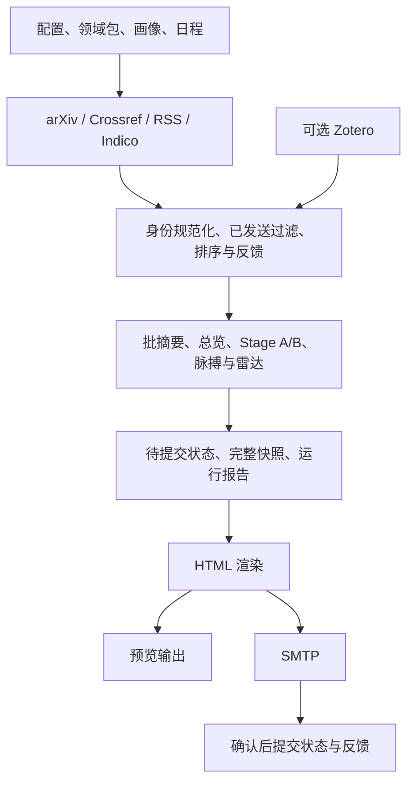

# 项目修复后重新审阅与评分报告

> 这是 v0.13 的历史复审。后续已在 v0.14 落实周日精选、跨领域资讯及下列问题的修复，见 [最新改动与验收](CHANGE_REPORT_2026-10-26_V014.md)。6.6 分是当时评分，不是对 v0.14 的新评分。

日期：2026-10-26（Asia/Shanghai）。对象：当前 v0.13.0 未提交工作区，Git HEAD `b8e56f8`。这是对修复后代码的重新审阅，不能用 HEAD 单独重建当前被审阅版本。

**综合评分：6.6 / 10；原基线为 5.1 / 10。结论：具备实际价值、工程基础明显改善的个人研究工具，适合有人监督的使用；尚不满足持续无人值守投递和科研内容可信度的完整验收。**

本轮登记 **2 项 P1、7 项 P2**：R01–R08 有隔离复现，R09 为代码与 GitHub 官方规则支持的高可信推断。没有确认 P0 问题，也没有据此证明不存在其他严重问题。主要扣分来自漏发后消费状态、展示字段的事实约束缺口、合并后清理失效，以及测试和外部验收不足。

本轮没有修复业务代码、修改配置/依赖、安装软件、真实调用模型、发送邮件或触发云端部署。新增本报告、[验证记录](REVIEW_2026-10-26_POST_FIX.validation.json)、[离线复现附件](review_assets/post_fix_probes.py)，并更新交接说明及改动报告的复审备注。保留原有未提交改动；没有 commit/push。

## 1. 审阅依据、范围与证据等级

沿用最初 A–N 十四个维度，补充科研信息处理专项。需求依据依次为当前 README、配置说明、现有接口与测试、产品计划。产品计划同时包含历史记录和未来规划，不能把其中每个设想当作当前版本已承诺需求。没有独立签字验收的需求规格；对隐含目标的判断在下文标为推断。

重新检查了主入口、流水线、状态与持久化、模型调用与证据处理、抓取/期刊/领域包、反馈、快照与消费者、邮件模板、全文处理、配置、测试及 Actions。结合近期五次 Git 记录查看状态同步、时区、领域选择等集中修改区域。不是对全部 Git 历史或所有外部组件的穷尽审计。

- **已验证**：实际隔离复现或明确的本地检查结果。运行结果仅适用于给定输入与当前环境。
- **高可信推断**：调用链与规则支持结论，但没有实际运行对应外部环境。
- **待验证风险**：有明确条件或验证缺口；不作为已经发生的事故或已确认漏洞。

评分采用与基线相同的十分制和等权平均。9–10 分要求实现、失败路径和实际环境证据充分；7–8 分表示核心机制可用且具备有效验证，仍有明显缺口；5–6 分表示有实用功能，但关键边界或运行保证不足。分数是审阅判断，**不是需求完成率、测试覆盖率、准确率或统计置信区间**。

## 2. 本轮实际验证

环境为 Windows、Python 3.11.9。执行前已检查测试和检查脚本：使用模拟抓取、虚假模型/SMTP、临时文件；Python 回归及新增附件阻断 socket 连接，自检额外注入相同的阻断。没有安装依赖。运行虚拟环境解释器需要沙箱执行权限，已通过自动审批；这不是项目运行故障。

| 检查 | 本轮结果 | 证据与边界 |
|---|---|---|
| `python -B -m unittest discover -s tests -v` | **63/63 通过**，退出 0 | 实际重跑；包含跨进程 ID/锁、真实 pypdf 工作进程、模拟入口事务等，非全真实集成 |
| `python -B -m arxiv_digest.selfcheck`，外加 socket 阻断 | **26/26 通过**，退出 0 | 实际重跑；配置、来源、分派、反馈、渲染等 |
| `tests/check_google_feedback.cjs` 的 `run()` | **10 项通过** | Node 环境实际执行；Google 服务是内存替代，无网络/文件写入，不等于 Apps Script 已部署通过 |
| `python -B -m pip --disable-pip-version-check check` | 退出 0，无依赖冲突 | 只核对安装元数据，不是漏洞扫描 |
| Python AST / YAML | 44 个 Python 文件、9 份配置 YAML、workflow 解析成功 | Python 范围为 `arxiv_digest/`、`scripts/`、`tests/`；不代表运行语义或 GitHub 服务端校验通过 |
| 固定依赖与本地环境 | 23 项固定版本全部匹配 | requirements 与已安装版本一致；没有构建/安装可复现性证明 |
| 新增定向复现 | **R01–R08 均观察到报告所述问题** | 复现程序退出 0 仅表示执行完成，不能计入“通过的产品测试” |

关键命令及逐项输出见[机器可读记录](REVIEW_2026-10-26_POST_FIX.validation.json)。可在仓库根目录重新执行：

```powershell
.\.venv\Scripts\python.exe -B docs/review_assets/post_fix_probes.py
```

本轮还沿实际 `pipeline.run_pipeline` 加强复现了脉搏错误导致整条流水线抛 `TypeError`；发送期间插入预览则直接复用了两个真实 `main` 调用。没有把 8 个新增探针加入既有 63 项回归，因此“现有测试全通过”和“仍有缺陷”同时成立。

没有测量覆盖率、性能、模型错误率、推荐收益、真实 SMTP 投递成功率；没有执行 Linux/macOS、Actions、真实 Apps Script、全量漏洞/许可证/历史秘密扫描、mypy 或 lint。本轮没有重新生成历史的 `preview_v013.html`，历史预览结果不冒充新执行结果。

## 3. 项目概览与架构判断

项目把 arXiv、Crossref 期刊论文、RSS/Indico 资讯等整理为面向个人研究者的中文邮件，结合领域包、关键词、Zotero 与反馈排序，提供精读、速览、七日脉搏、邻域雷达和日程。主要使用场景是单用户每日批任务；从当前实现推断，不是多租户在线服务或科研数值计算平台。

核心栈为 Python 3.11+、标准库 urllib/XML/SMTP、Jinja2、PyYAML、pypdf、OpenAI 兼容 SDK；配置采用环境变量和 YAML，持久化采用 JSON 文件，无数据库。外部集成包括 arXiv、Crossref、Zotero、RSS/Indico、模型端点、SMTP、可选反馈 Sheet/Apps Script，以及 GitHub Actions。



主要职责分界清晰：`identity.py` 负责身份，`storage.py` 负责原子替换/进程锁，`state.py` 负责历史和统计，`contracts.py` 负责快照转换，`analysis.py` 负责事实与评论，`pipeline.py` 负责编排，`main.py` 负责投递边界。当前规模不需要因为“架构升级”而引入数据库、微服务或插件框架。

架构弱点在**共享的业务语义没有完全统一**：什么算可投递内容、哪些展示字段属于受证据约束的事实、远端合并后谁负责维护保留期、诊断文件属于哪次运行。R01/R02/R03/R07 分别暴露这些跨模块约定的缺口。单独增加抽象层不能代替把约定落实到调用链与验收。

## 4. A–N 评分

| 维度 | 原基线 | 本轮 / 10 | 主要依据与扣分原因 |
|---|---:|---:|---|
| A 需求完整性与实现 | 5 | **7** | 领域包、反馈、完整快照与多源链路真实接入；雷达单独投递和固定数据集评测仍不闭环（R01/R08） |
| B 功能正确性 | 4 | **6** | 去重/日期归属/评分同步有回归；仍能输出无依据数字、遗漏归零下降，限流策略被覆盖（R02/R05/R06） |
| C 代码质量 | 6 | **7** | `contracts.py`、`identity.py`、`storage.py` 减少重复转换和副作用散落；模型对象边界校验不完整（R04） |
| D 架构合理性 | 7 | **7** | 适合单用户批处理，准备/提交分离合理；跨模块投递、证据与状态不变量尚未统一 |
| E 可维护性与技术债 | 5 | **7** | 有交接、迁移约定和有效回归；815 行 pipeline 聚集多种协调规则，改内容类型仍易遗漏主入口判定 |
| F 可扩展性 | 5 | **7** | 新领域/期刊规则可通过 YAML，模型兼容参数有隔离；新增来源协议或内容类型仍需跨抓取/模型/渲染/提交修改 |
| G 性能与资源效率 | 5 | **6** | 下载/解析有边界，Stage A/全文有缓存；串行 I/O、重试耗时、缓存生命周期尚无基准或长期验证 |
| H 安全与隐私 | 4 | **7** | SMTP 验证证书并设超时、反馈签名/确认、公开 state 不写票值、Zotero 默认不外发；未完成全供应链审计和公网服务加固 |
| I 可靠性与容错 | 4 | **6** | 原子写、进程锁、发送后提交、来源降级有效；R01/R03/R04/R06 与 SMTP 后崩溃窗口仍影响持续运行 |
| J 测试与可验证性 | 4 | **7** | 新重跑 63 回归 + 26 自检 + 10 JS 检查，有真实解析/进程边界；缺整体内容质量验收和新增边界回归 |
| K 第三方依赖与供应链 | 6 | **6** | requirements 全固定、pip check 正常、关键下限提高；无哈希锁、Actions 未固定 SHA、完整漏洞/许可证状态不明 |
| L 部署、配置与兼容性 | 5 | **6** | 安装/运行指引及 PR/push 验证配置更完整；只实测 Windows，云端并发/合并/诊断路径存在缺口 |
| M 文档与开发体验 | 6 | **7** | 中英文 README、配置、反馈、改动与交接材料较齐全；产品计划历史口径与现评测实现存在差异，缺真实联调验收记录 |
| N 可观测性与工程成熟度 | 5 | **7** | 有阶段耗时、调用用量、来源与交付状态、诊断 artifact；快照归属可混淆，失败时报告并非始终生成（R07） |
| **等权平均** | **5.1** | **6.6** | 原总分 71/140；本轮 93/140，未四舍五入均值 6.642857 |

评分上升反映真实机制和验证的改善；B/I/L 仍为 6 分，是因为尚存影响输出、状态和部署的缺陷。没有把所有维度简单随测试数量上调。

## 5. 需求—实现—验证矩阵

“已验证完成”均受表内本地/离线范围限制；不能外推为外部服务验收通过。

| 需求来源 / 目标 | 实现位置 | 状态 | 本轮证据 / 剩余问题 |
|---|---|---|---|
| README：领域、画像决定抓取与评审 | `packs.dispatch`、`pipeline._resolve_categories`、`_assessment_packs` | 已验证完成（离线范围） | 主分类优先、generic、新包词表回归；真实领域相关性仍需人工衡量 |
| README：分页、自适应抓取、期刊补充 | `arxiv_client.fetch_recent_papers`、`journals.fetch_journal_papers` | 部分实现 | 服务端日期过滤、闸门后限额有回归；远端完整度/元数据质量未实测，429 策略见 R06 |
| README：个性化排序与库内识别 | `recommender`、`feedback.apply_feedback`、`zotero_client` | 部分实现 | 分数与星级、CSV 元数据与逐维时间合并通过；只覆盖已获取 Zotero 条目，长期推荐收益证据不足 |
| README：分批摘要与完整总览 | `llm.generate_digest_content` | 部分实现 | 总览使用全体入选论文、批次失败降级通过；真实摘要事实性/翻译质量未验收 |
| README：两阶段精读及证据 | `analysis.extract_bundle`、`assess` | 实现存在错误 | Stage A 引文/数字、basis 已约束；R02 展示字段仍绕过数字核验 |
| README：全文节选与降级 | `fulltext`、`pipeline._maybe_analyze` | 部分实现 | 真实一页 PDF 子进程提取、大小/超时失败路径通过；无内存硬上限和真实复杂 PDF 验证 |
| README：HTML、主题、MIME 附件 | `emailer`、模板、`theme` | 已验证完成（离线范围） | 26 自检及模板/附件/URL 回归；邮件客户端和真实 SMTP 不在已完成范围 |
| README：预览不消费状态 | `main._run` 的 out 分支 | 已验证完成（已读状态范围） | 真实入口回归不发送、不提交 seen；仍写诊断/缓存，诊断并发见 R07 |
| README：发送成功才消费、稳定去重 | `main._run`、`commit_delivery`、`identity` | 实现存在错误 | 常规成功/失败/重跑通过；雷达单独出现被错误消费（R01） |
| 配置：状态保留期与数量边界 | `state.prune`、`merge_states`、Actions | 实现存在错误 | 本地清理存在；远端合并将已清理数据恢复（R03） |
| README：独立来源容错与重试 | `pipeline._collect_world`、`sources` | 部分实现 | 失败来源不记 fetched、主源故障保留资讯路径；全部无内容时原异常类型丢失（R06） |
| README：近七日材料脉搏 | `pipeline._remember_materials`、`pulse` | 实现存在错误 | 材料跨轮保留、引用 ID 过滤通过；类型错误可中止流水线（R04），引用存在不等于论断成立 |
| README：邻域雷达与已读去重 | `radar.select_hits`、`pipeline._build_radar` | 实现存在错误 | 身份可标记；没有覆盖雷达独立邮件（R01） |
| README：采集趋势 | `state.record_observations`、`weekly_trend` | 实现存在错误 | 按发表日、主分类、canonical ID 去重通过；归零分类消失（R05）；本身只是采集样本 |
| README：两维反馈与云端后端 | `feedback`、`feedback_security`、反馈脚本 | 部分实现 | 本地与 JS 离线检查通过；实际私有 Sheet 权限、跨服务签名和部署待验收 |
| README：日程与配置时区 | `calendar`、`pipeline._run_pipeline` | 已验证完成（本地静态数据范围） | 配置时区参与日期计算、自检读取成功；日程事件真实性/是否过时不由自检证明 |
| README：快照可供回放、评测、反馈 | `contracts`、`pipeline._write_digest_json`、相关 scripts | 部分实现 | 完整往返和消费者回归通过；并发预览可污染诊断归属（R07） |
| 产品计划：固定约 20 篇质量评测 | `scripts/eval_analysis.py` | 部分实现 | checker 可消费新快照；缺把固定输入集送入全部分析的 runner，默认流程不闭环（R08） |
| README/Actions：定时无人值守 | workflow、`main.run_cli` | 证据不足，并有缺陷 | 未跑真实云端；R03/R06/R09 影响运行保证 |
| 推断目标：持续使用后推荐更有用 | 反馈学习、评分与画像 | 证据不足 | 没有人工标注、对照或纵向指标，不能根据“存在学习代码”认定收益 |
| 产品计划：修订提醒、社区信号等 | 计划材料 | 未实现/规划 | 当前明确按 arXiv 去版本 ID 去重，不做修订提醒；不作为本版本必交功能扣重分 |

## 6. 重要问题登记与可验证改进

优先级：P0 为灾难性或正在发生的严重事故；P1 为应先修复的核心正确性/数据问题；P2 为近期修复项。以下 ID 是**本轮重新登记的问题**，不表示每项都由上一轮修改新引入；没有通过历史二分确认引入提交。

### R01 · P1 · 仅有雷达内容时，不发信却消费条目

**已验证，置信度高。** [main.py:74](../arxiv_digest/main.py#L74) 的空内容判定只检查 `enriched/secondary/talks`，不检查 radar；[pipeline.py:785](../arxiv_digest/pipeline.py#L785) 已把雷达 hits 放进 pending seen。于是调用 `commit_delivery` 后跳过 SMTP。

复现：主区和资讯均为空，`_build_radar` 返回一条 `2610.98765`。两个实际入口阶段完成后，`smtp_calls=0`、`snapshot_has_radar=true`、`seen_without_delivery=true`。下次雷达过滤将跳过这条未投递内容。这不需要网络攻击或外部故障；主区被已读/评分过滤而邻域仍有新文即可触发。仅日程/脉搏是否应独立发信属于需要明确的产品策略，不能混同于已经确认的雷达丢失。

改进：统一可投递内容判断，至少纳入非空 radar；seen 只接收最终邮件实际包含的条目。空采集结果需要提交抓取进度时，不得顺带消费未发内容。

验收：增加真实 `main` 链路测试，分别覆盖仅雷达、仅主区、全部为空；仅雷达成功应发一次并提交，SMTP 失败不得写 seen，完全空白不得误发。先定义仅日程/脉搏的策略，再加相应断言。

### R02 · P1 · 精读卡片部分字段绕过事实数值核验

**已验证，置信度高。** [analysis.py:569](../arxiv_digest/analysis.py#L569) 仅核验 FACT_KEYS、background、method_detail、verdict；`for_you`、`actions`、`chain` 等可见内容没有相同约束。模板直接显示方法链与行动建议（[模板:377](../arxiv_digest/templates/digest_email.html#L377)、[模板:461](../arxiv_digest/templates/digest_email.html#L461)）。

复现：原文只有 “We measure 42 clusters.”；Stage A 保留真实 42，Stage B 的结果仍写 42，同时在三个未检查字段中声称论文测得 999。分析和真实 HTML 渲染均成功，页面出现 3 次 999，原文中没有 999。攻击前提不是必须有人注入：模型生成普通错误输出即可触发；若外部文本影响生成，也不能依赖 prompt 保证事实性。没有测量真实模型发生频率。

改进：按“原文事实、程序统计、建议/假设”界定字段语义，对所有承载论文事实的展示字段执行来源核对；建议中有合法的新数字（例如“抽查 3 篇”），不能一律按原文数字过滤。必要时把事实引用和建议分开存储并标清，避免把建议包装成论文结论。

验收：合法 42 保留；“论文测得 999”的说法在所有展示路径被拒绝或明确降级；“建议抽查 3 篇”作为建议可以保留；覆盖 actions、chain、for_you、红旗说明、阅读理由与单阶段摘要入口。另用人工标注评估语义，不以正则核对代替科学审核。

### R03 · P2 · 云端合并复活已清理状态，突破保留上限

**已验证，置信度高。** [state.py:148](../arxiv_digest/state.py#L148) 清理 seen/observations/materials；但 [state.py:255](../arxiv_digest/state.py#L255) 对 remote/local 取并集后不再 prune。[merge_state.py:19](../scripts/merge_state.py#L19) 直接保存；[workflow:206](../.github/workflows/daily-arxiv-digest.yml#L206) 每轮成功后都走该路径，并不限于真的发生并发冲突。

复现：local 已删除的 2025-01-01 seen、材料和观察记录全部被 remote 恢复；另一个样例 local 恰好清到 5000 条，merge 后变为 5001 条。长期云端运行可能保留过期资料、增加仓库/解析成本，并破坏预期遗忘策略；没有做多年运行或内存压测。

改进：把运行日期、配置时区和统一保留策略传入合并，在并集后执行清理；避免用 UTC 当前日期隐式替代本轮业务日期。保留两次成功投递的必要集合，同时明确旧版删除/修正语义。

验收：测试过期 seen/observations、七日材料及数量上限；固定日期重复 merge 保持幂等，两端有效新投递均保留，个人票值仍不进入公开 state。

### R04 · P2 · 合法 JSON 的异常字段类型使脉搏中止整个任务

**已验证，置信度高。** [pulse.py:465](../arxiv_digest/pulse.py#L465) 直接遍历 `headline_evidence`；[pulse.py:550](../arxiv_digest/pulse.py#L550) 的 `coerce_pulse` 调用在异常降级 try 之外；[pipeline.py:286](../arxiv_digest/pipeline.py#L286) 直接调用 compose。

复现：模型返回合法 JSON `{"headline":"valid","headline_evidence":42}`，有真实材料与主题时抛 `TypeError: 'int' object is not iterable`。既在 compose 入口复现，也在实际 `run_pipeline` 路径复现；没有进入承诺的主题统计 fallback，其他可用论文也无法继续投递。

改进：在外部 JSON 边界校验字段类型；把结构转换与校验纳入局部降级范围并记录阶段/原因，不吞掉整个流程的真实错误。

验收：null、整数、字符串、字典、混合数组、无效 evidence ID 分别测试；错误输出返回统计版脉搏或无脉搏，正常主区仍可渲染/发送。

### R05 · P2 · 周趋势遗漏从有采集降到零的分类

**已验证，置信度高。** [state.py:242](../arxiv_digest/state.py#L242) 只遍历 this_week 的键；本周没有出现的上周分类不会进入结果。若本周全部为空，还会提前返回。

复现：上周 CO=10，本周 CO=0、GA=2，结果只有 GA，CO 的完全下降被隐藏。这是静默错误，已有“2→5”的正向自检无法发现。

改进：对两周分类并集生成变化，明确采集缺失和真实采集到零的区别；不足覆盖时显示不可比较，不能把网络故障等同零投稿。

验收：覆盖 10→0、0→10、两周均零、采集断档及 limit；标题与说明持续标明“采集样本变化”，不能冒充全量投稿统计。

### R06 · P2 · 主源限流异常被包装，graceful 配置不再生效

**已验证，置信度高。** [pipeline.py:744](../arxiv_digest/pipeline.py#L744) 捕获原 `ArxivRateLimitError`，在其他来源也无内容时由 [pipeline.py:771](../arxiv_digest/pipeline.py#L771) 抛普通 RuntimeError；[main.py:156](../arxiv_digest/main.py#L156) 的专用限流分支因而收不到原异常。

复现：配置 `arxiv_rate_limit_graceful=True`，模拟 arXiv 429 且没有其他内容，实际 `run_cli([])` 通知一次后仍抛 RuntimeError，没有按配置返回 0。允许其他来源继续的改进是有价值的，但不应抹去最终错误分类。

改进：保留原异常/结构化采集状态，只有确认无其他可投递内容后执行既定限流策略；普通抓取故障继续保持失败，不要为“全绿”统一返回成功。

验收：429+graceful true/false、429+可用资讯、普通网络错误、通知失败、out 预览分别断言退出行为与状态不消费。

### R07 · P2 · 并发预览可让未发快照被标为 committed

**已验证，置信度高，条件性触发。** [main.py:31](../arxiv_digest/main.py#L31) 只为正式发送持有 delivery_lock，预览可同时使用相同诊断路径；[pipeline.py:698](../arxiv_digest/pipeline.py#L698) 更新当前文件，没有确认它属于本次 result。

复现：A 准备论文 `2610.11111` 并进入模拟 SMTP；在此间通过实际 `main(..., out=...)` 完成 B 的预览（`2610.22222`），再让 A 提交。最终 state 仅含 A，digest.json 却含 B 且 `delivery=committed`。不需要真实线程即可按同样顺序重现竞态。它影响诊断/评测来源的可信度；没有证据表明该样例改变了真实发送的正文或已读 state。

改进：为每轮提供不可混淆的 run ID 和独立产物路径，更新时核验归属；预览、正式邮件和诊断快照使用明确的关联关系。原子替换只能避免半文件，不能避免把别人的完整文件改错。

验收：固定模拟交错顺序，A 的报告只关联 A 内容，B 保持 preview；同时覆盖快照写失败和报告失败，业务投递不受可选诊断影响。

### R08 · P2 · 固定评测集与每日选择流程没有闭环

**已验证配置/行为，置信度高；不是“所有评论都不准确”的证据。** [eval_analysis.py:196](../scripts/eval_analysis.py#L196) 的 build 默认抓 20 篇；默认每日只展示 14 篇、精读 4 篇（[config.py:230](../arxiv_digest/config.py#L230)）。build 只写期望集合，没有把这一集合交给分析 runner；check 又要求覆盖全部 entries（[eval_analysis.py:183](../scripts/eval_analysis.py#L183)）。另见产品计划历史口径“覆盖只统计、不设线”（[PRODUCT_PLAN:1076](PRODUCT_PLAN.md#L1076)）。

复现：评测集 20 条、快照中 4 条均有真实有效引文，输出覆盖 4/20、引文 4/4，退出 1。checker 对完整覆盖的要求可以是合理策略，缺口是文档描述的默认操作不足以执行这个策略；此外重复抓取时的日期和排名也不能保证输入集合一致。

改进：增加可重复的固定输入评测流程，或明确记录如何对齐输入/篇数/精读设置；区分“未运行”“运行失败”“质量未达标”。维护人工审核集，不能仅把正则提取数字当 gold label，也不要简单降低门槛隐藏未覆盖。

验收：给定固定 20 篇快照，不重新抓取就能逐篇分析/检查并报告覆盖与质量；缺失条目与无效引文分别有明确失败原因；文档与退出策略一致。

### R09 · P2 · 验证与投递共用全局并发组，待执行邮件可被替换

**高可信推断，未在真实 Actions 复现。** workflow 的 push、PR、schedule、dispatch 全部共享 [workflow:20](../.github/workflows/daily-arxiv-digest.yml#L20) 的 `daily-digest` 并发组，`cancel-in-progress:false` 仅保护已运行任务。[GitHub 官方文档](https://docs.github.com/en/actions/how-tos/write-workflows/choose-when-workflows-run/control-workflow-concurrency) 明确默认同组只保留一个 pending，新排队任务会替换已有 pending。

触发序列：已有验证在运行 → schedule 邮件处于 pending → 再来一个 push/PR 验证。pending 邮件可能被新验证替换。影响是漏掉本次定时任务；没有证据表明当前仓库已发生。

改进：把代码验证并发与投递串行约束分开，例如对 send job 单独设置投递组，验证按分支/PR 分组；结合实际队列策略验收，不能只更改 cancel-in-progress 值。

验收：受控分支验证上述排队序列；无发信权限的验证不得取消待执行投递，两次真实投递仍不得并发。该验收需要真实 Actions，不能用 YAML 解析冒充。

## 7. 原审阅 F01–F16 的复核状态

基线原文保存在 [REVIEW_2026-10-26.md](REVIEW_2026-10-26.md)。下表只给出本轮可支持的完成边界。

| 原问题 | 当前结论 | 本轮依据 / 残留 |
|---|---|---|
| F01 SMTP TLS | 已验证修复（构造范围） | `emailer.send_email:279/284` 使用安全 context 与 timeout；测试同时覆盖 SSL/STARTTLS，真实邮件未测 |
| F02 发送前消费/预览污染 | **部分修复** | 常规预览、渲染失败、SMTP 失败不消费已验证；R01 空判定仍可误消费 |
| F03 Python hash 持久 ID | 已验证修复 | RSS/Indico 调用 `identity.stable_id`，跨进程 hash seed 回归通过 |
| F04 论文去重/雷达记忆 | **部分修复** | 主区先 filter_unseen、重复发送测试通过；雷达正常身份接入，但独立投递见 R01 |
| F05 重复/日期错误计数 | **主要根因修复，仍有相关缺陷** | `record_observations` canonical ID/发表日/主分类回归通过；R05 归零遗漏，R03 合并保留问题 |
| F06 CSV 元数据与学习 | 已验证修复（本地链路） | 空 store 导入、持久 history、CSV 引号与逐维时间回归通过；真实 Sheet 待验收 |
| F07 导出与消费者契约 | 已验证修复（串行契约） | `contracts` 往返、eval/replay/feedback 消费通过；并发诊断归属另见 R07 |
| F08 引文/依据/头条校验 | **部分修复** | Stage A 子串/数字、程序 basis、头条 evidence ID 约束通过；R02 未覆盖字段、语义真实性未证实 |
| F09 失败来源记 fetched | 已验证修复 | `_collect_world` 只记录成功来源，失败 weekly 来源可再试 |
| F10 workflow 配置未注入 | 主要映射已补齐，云端待验收 | Send env 可见反馈、Zotero 等映射；历史 96 项映射统计未在本轮重新逐项计算 |
| F11 闸门前限额 | 已验证修复 | “前六篇不相关、第七篇相关”测试与新包自定义规则通过 |
| F12 星级未随反馈更新 | 已验证修复 | 总分/星级同步回归通过 |
| F13 汇总范围/非周材料 | 主要范围修复，仍需边界验收 | 总览完整输入、近七日跨轮材料回归通过；R03/R04 与材料截断仍限制运行保证 |
| F14 坏状态类型崩溃 | 已验证修复（既有样例） | v1 迁移、未知版本、坏字段/坏材料回归通过；不能推断所有任意 JSON 都安全 |
| F15 回放偷偷下载 | 已验证修复 | 默认回放禁下载，兼容旧 fulltext flag 测试通过；显式 fetch-fulltext 属另一路径 |
| F16 公式分组破坏 | 已验证修复（已覆盖表达式） | `mathfmt` 分组回归通过；不是任意 LaTeX 的完整转换器 |

## 8. 其余维度的专项判断

### 安全、隐私与供应链

安全改善有直接代码证据：[emailer.py:279](../arxiv_digest/emailer.py#L279) 验证 SMTP 对端；[feedback_security.py:24](../arxiv_digest/feedback_security.py#L24) 核对签名与时效；本机端点 GET 不直接写票、POST 使用 nonce、公开监听需要 signing key（[feedback_server.py:179](../scripts/feedback_server.py#L179)）；[pipeline.py:681](../arxiv_digest/pipeline.py#L681) 保存的公开 state 清空 votes；`ZOTERO_SHARE_WITH_MODEL` 默认 false。有限检查确认 `.env` 未跟踪且被忽略，没有输出凭据内容。本轮没有据此声称整个 Git 历史无秘密。

剩余风险需要明确前提：

- **公网反馈端点资源耗尽，静态风险。** 若把当前 `ThreadingHTTPServer` 直接暴露公网，攻击者可建立慢请求；[feedback_server.py:131](../scripts/feedback_server.py#L131) 阻塞读取 body，没有应用级 socket 超时/并发总上限。影响是线程/连接耗尽。默认 localhost 场景暴露面小；未实施攻击或压测，公网部署应由受控入口限流/超时。
- **PDF 资源风险，部分缓解。** 25 MiB、页数/文本、可终止解析已接入；子进程没有跨平台内存硬上限。恶意或复杂远端 PDF 仍可能在时限内消耗大量内存，未实际测量峰值。不可把“放进子进程”称为完整安全沙箱。
- **敏感来源元数据风险，条件性。** 未来若配置私有 feed 或带凭据 URL，state/materials、快照、diagnostic artifact 的访问范围需要同步检查。默认公开论文并不等于所有可配置来源都公开；目前没有确认默认流程泄漏凭据。
- **外发范围。** 摘要/全文节选、画像会用于模型生成；Zotero 标题/标签须显式开启才外发。对私有研究材料，需按实际供应商与使用授权确认范围，本轮没有向供应商发送测试数据。

requirements 的 23 项固定版本与本地一致，pyproject 仍是宽下限而非锁文件；Actions 使用版本标签，没有固定提交 SHA；安装没有包哈希约束。不能据“没有冲突”判断“没有漏洞”。本轮查验的 [pypdf 公告](https://github.com/py-pdf/pypdf/security/advisories/GHSA-gmh7-3g9r-mjh5) 影响 `<6.21.2`，仓库固定 `6.21.2` 不落入**该条公告**范围；[Jinja 3.1.6 官方发布说明](https://github.com/pallets/jinja/releases/tag/3.1.6) 包含安全修复。没有确认这两者或全部传递依赖的整体漏洞状态。仓库有 LICENSE，未完整核验依赖分发条款，因此许可证兼容性结论仍待核实。

### 性能、可靠性与可观测性

[fulltext.py:100](../arxiv_digest/fulltext.py#L100) 下载上限、[fulltext.py:168](../arxiv_digest/fulltext.py#L168) 解析超时、[analysis.py:265](../arxiv_digest/analysis.py#L265) Stage A 缓存、[storage.py:12](../arxiv_digest/storage.py#L12) 原子替换与 [storage.py:31](../arxiv_digest/storage.py#L31) OS 锁是有效改进。不是性能达标证据：arXiv 分页与退避、期刊、逐篇全文/分析大体串行，最坏耗时可能叠加；45 分钟云端超时是否适配真实服务故障没有实测。多层 SDK/应用重试也需要统一预算。

本地全文和提取缓存没有总大小/过期清理；随着论文数量增长可能占用磁盘。Actions 仅缓存 pip，业务 CACHE_DIR 没有配套持久化步骤，不能假定跨云端运行命中缓存。状态清理还受 R03 影响。以上为静态性能/运维风险，没有声称已经出现特定资源瓶颈。

SMTP 接受后、状态保存前若进程崩溃，仍可能重发；这是已经披露的事务窗口，不宜宣称 exactly-once。原子 JSON 防止半文件，但不能把 SMTP 和磁盘变成一个事务。跨机器/网络文件系统、多用户同时写不属于已验证范围。

当前 report 包含用量、来源、错误和状态，但主要在流水线成功收尾时构建；若 R04 等在此之前抛错，不能保证产生本次完整诊断。无内容分支仍标 committed，没有明确 skipped 状态。另有条件性路径问题：workflow 的 `DIGEST_JSON_PATH` 可配置（第 108 行），上传却固定 `digest.json`（第 178 行），自定义路径会丢失对应 artifact，且 `if-no-files-found:ignore` 不提示。应让 run ID、失败阶段、投递结果和产物路径一致可追踪。

### 科研与数学专项

项目不训练模型、不做物理拟合或数值模拟，训练/验证集泄漏、优化收敛、物理求解器误差传播不适用。**适用的是科研信息的保真、来源追踪和可复现性，不能因此整体标为不适用。**

数值归一化支持部分中文单位和范围，公式分组有回归，source_text/hash/scope 已进入快照，全文 UI 标为节选。这些机制能约束部分低层错误，不能证明物理量、单位维度、坐标系、显著性与因果解释正确；42% 与 42 个样本即使数字相同，也需要语义判断。R02 是仍会产生无原文支持数值的直接反例。

采集趋势不是全量投稿统计；脉搏的别名命中和“多源”也不能证明独立证据或社区共识，同一论文被多个站点转述不是独立实验。当前证据 ID 约束验证的是引用存在，不是引用蕴含论断。

要验收内容质量，需要冻结输入文本、模型标识/参数、prompt 版本、领域包和画像版本，配合人工标注与参考答案。模型服务未必能保证完全确定性；保存快照和原文 hash 比只设置随机种子更实际。尚无模型幻觉率、单位正确率或长期推荐收益的可报告测量值。

### AI 辅助代码常见风险

不根据风格猜测代码是否由 AI 生成。实际存在的相似风险有：局部校验看似完善但漏掉其他展示路径（R02）、函数注释承诺“任何失败 fallback”而类型转换在保护范围外（R04）、局部修复未延伸到全局判定（R01）、文档评测操作与当前行为不闭环（R08）。没有发现足以据此断言“业务全是 Mock”的证据：Mock 主要用于测试/回放，真实抓取、模型、SMTP 实现均存在并接入，但其外部可用性仍需联调。

## 9. 改进顺序与验收路线

| 顺序 | 工作 | 完成条件 |
|---|---|---|
| 1 | 修复 R01/R02，并补真实入口/真实渲染回归 | 不再未发消费；所有事实展示路径对 999 反例有一致处理，合法建议不被误删 |
| 2 | 修复 R03/R04/R06 | 合并保持保留期/上限；异常 JSON 局部降级；退出策略与配置一致 |
| 3 | 修复 R05/R07/R08 | 归零/缺测区分；并发快照归属正确；固定输入评测可重复跑完 |
| 4 | 修复 R09、上传路径与失败报告 | 验证和投递队列隔离；配置路径可诊断；失败阶段留下本次记录 |
| 5 | 建立最小真实验收 | 受控少量论文先只出 HTML，人工逐句核对；随后单独验 SMTP、私有反馈后端及 Actions |
| 6 | 再量化长期质量与性能 | 固定人工审核集、连续运行观察；记录耗时/成本/错误与推荐效用，再决定并行化、缓存策略和更大重构 |

下一轮不应通过减少断言或只更新文档来“消除”缺陷；应把复现附件中的错误观察改写为期望正确行为的回归测试，再对照实际调用链验证。外部部署、真实发信与模型付费调用应独立安排，不是本次只读审阅的隐含执行步骤。
